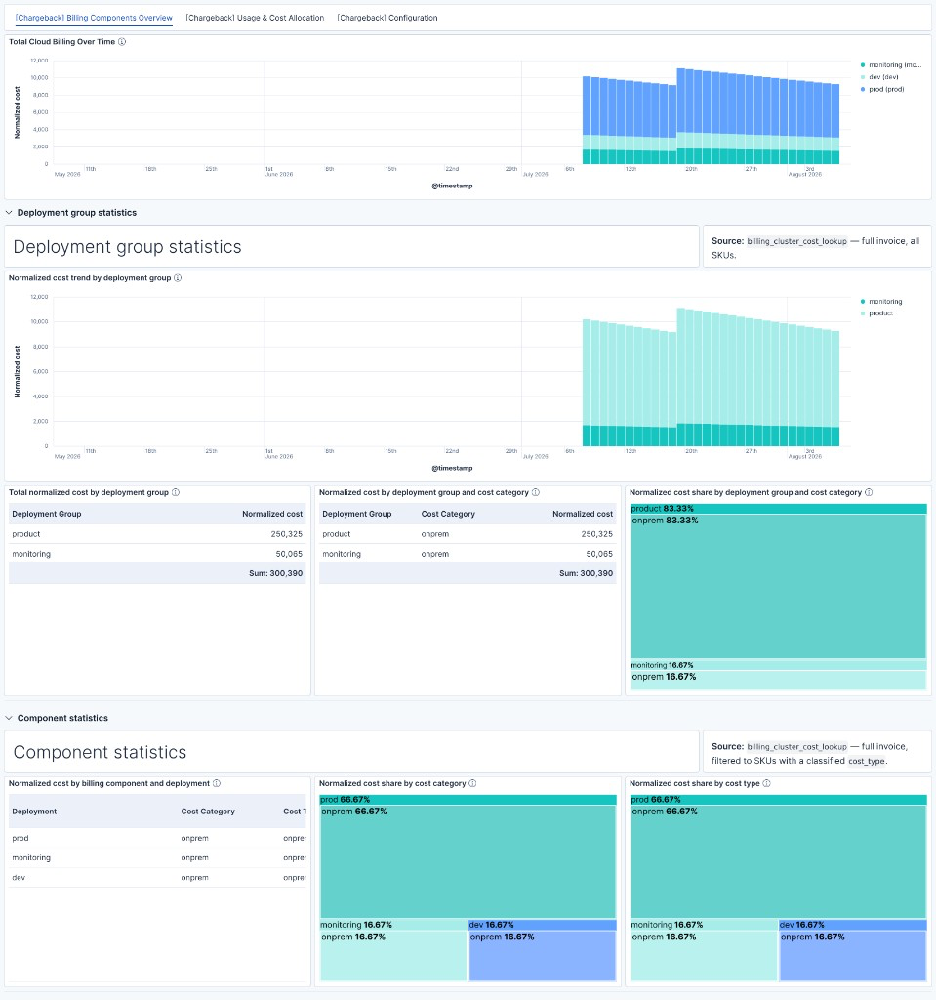
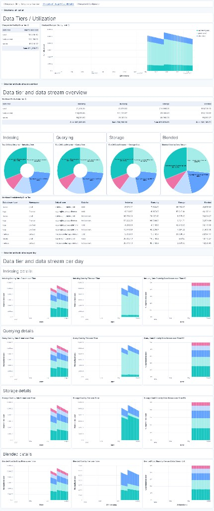
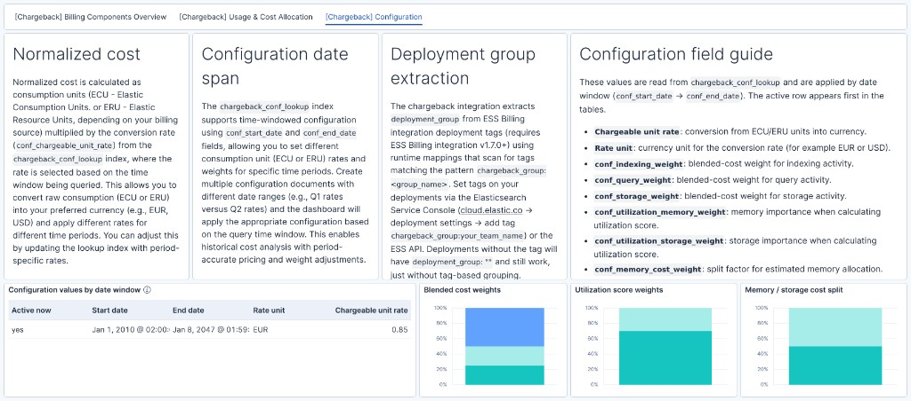

# Elasticsearch Chargeback

FinOps is an operational framework and cultural practice designed to maximize the business value of cloud usage. It enables timely, data-driven decision-making and fosters financial accountability through collaboration between engineering, finance, and business teams.

The **Chargeback integration** helps you answer a key question: How is my organization consuming the Elastic solution, and to which tenants can I allocate these costs?

Chargeback is based on the **Elasticsearch Service Billing** and **Elasticsearch** integrations. Its purpose is to provide data for chargeback calculations, offering a breakdown of chargeable units per:

- Deployment
- Data tier
- Data stream
- Day

## Pure Chargeback and add-ons

The Fleet package is **pure chargeback**: allocate invoice cost from billing and usage. It recognizes Elastic Cloud Hosted and Serverless **billing** SKUs (search/ingest VCU and retained storage; ML VCU stays out of the allocatable pool).

Anything that needs per-environment secrets, Agent Builder, or Kibana Workflow asset types that Fleet cannot ship lives outside the zip as an add-on in this repository:

| Layer | What it is | When you need it |
| --- | --- | --- |
| **Pure Chargeback** (Fleet zip) | Transforms, pipelines, dashboards, conf | Every install |
| **Add-on: Serverless usage collector** ([`serverless/`](serverless/README.md)) | One looping Kibana Workflow plus staging index | Per–data-stream showback for Serverless projects (billing already works from the zip) |
| **Add-on: Chargeback companion agent** ([`agent/`](agent/README.md)) | Agent Builder tools, skills, and agent | Optional report and Q&A over the lookup indices |

Without the Serverless collector, Serverless cost still appears in the realized pool; datastream contribution may be empty. With the collector, usage follows the same allocation path as Hosted. The agent never blocks Chargeback.

Field presents add-ons with docs and install scripts in this repository. They are not inside the Fleet zip.

## Support

Chargeback is created and supported by Elastic **Field** (Customer Engineering), not Elastic Product. It is **not** generally available (GA). While it remains in technical preview, get help through Field—for example your Elastic account team or the Elastician who shared this work with you. Standard Elastic Support does not cover it until that is explicitly arranged.

When Chargeback reaches GA, **Field** will coordinate with **Elastic Support** to put an official support model in place for entitled customers.

## Installation

1. Install pure Chargeback: follow the [Chargeback integration instructions](integration/Instructions.md). For package details, version compatibility, and data flow, see the [integration README](integration/README.md).
2. Optional — Serverless usage breakdown: after integration **0.5.0+**, run [`scripts/install_serverless_usage.sh`](scripts/install_serverless_usage.sh) and follow [`serverless/Instructions.md`](serverless/Instructions.md).
3. Optional — conversational reports: run [`scripts/install_chargeback_agent.sh`](scripts/install_chargeback_agent.sh) and follow [`agent/Instructions.md`](agent/Instructions.md).

## Dashboards

Chargeback ships three focused dashboards. Screenshots from local stack testing (0.4.x):

### [Chargeback] Billing Components Overview

### [Chargeback] Usage and Cost Allocation

### [Chargeback] Configuration

## Troubleshooting

If the Chargeback dashboard is empty after install, see **[integration/docs/troubleshooting.md](integration/docs/troubleshooting.md)** (step-by-step checks for billing/usage data, transforms, lookup indices, and configuration).

## Legacy: Chargeback module

An earlier, manually assembled **Chargeback module** still exists in this repository for environments that cannot meet the integration’s stack version requirements. It is not maintained and is not the recommended path.

If you need it, see the [Chargeback module README](module/README.md) and [module installation instructions](module/Instructions.md).
