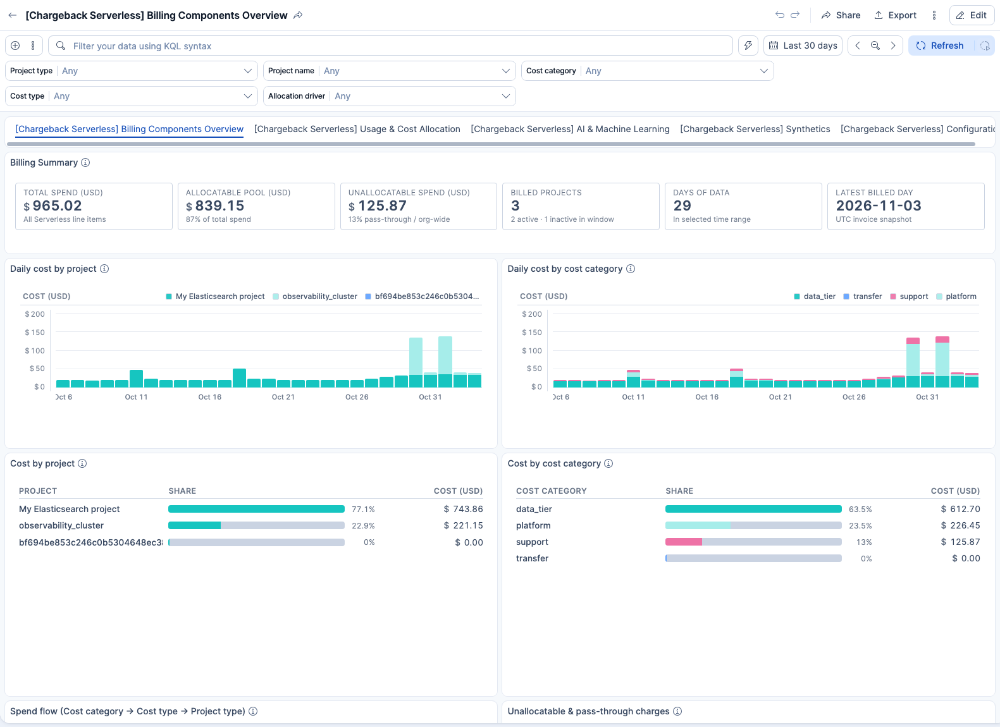
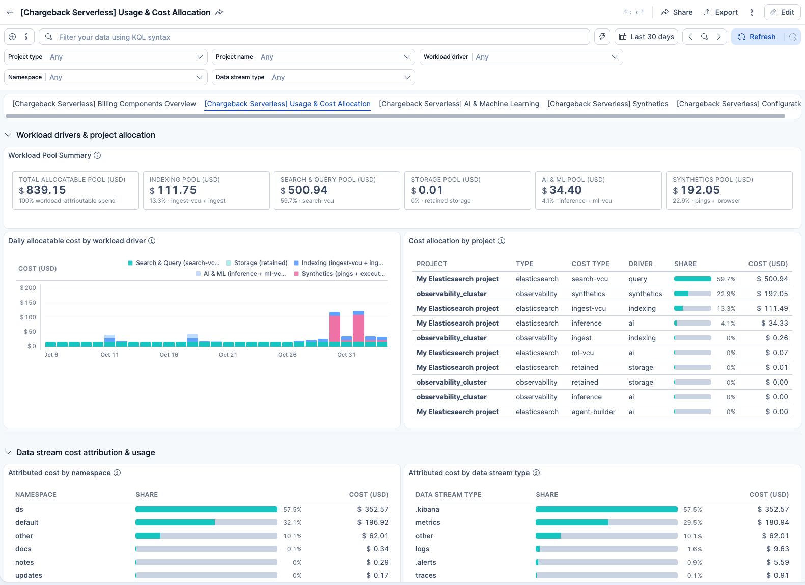
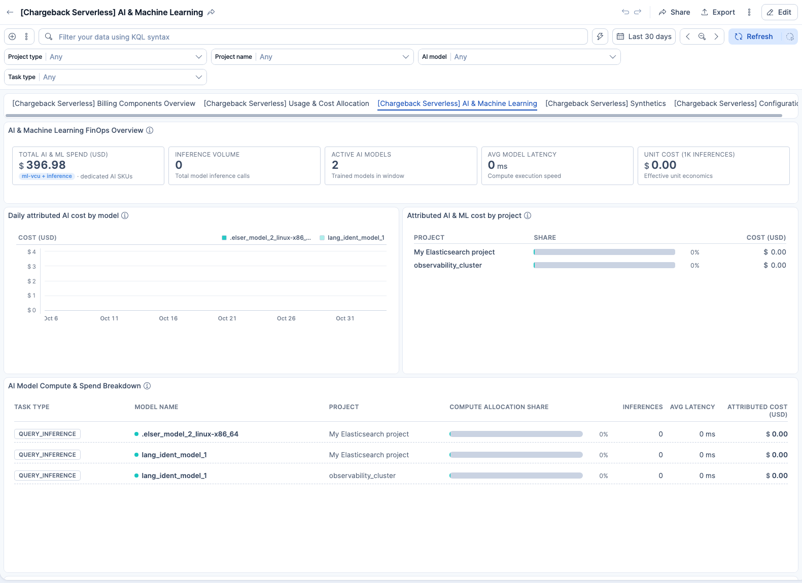
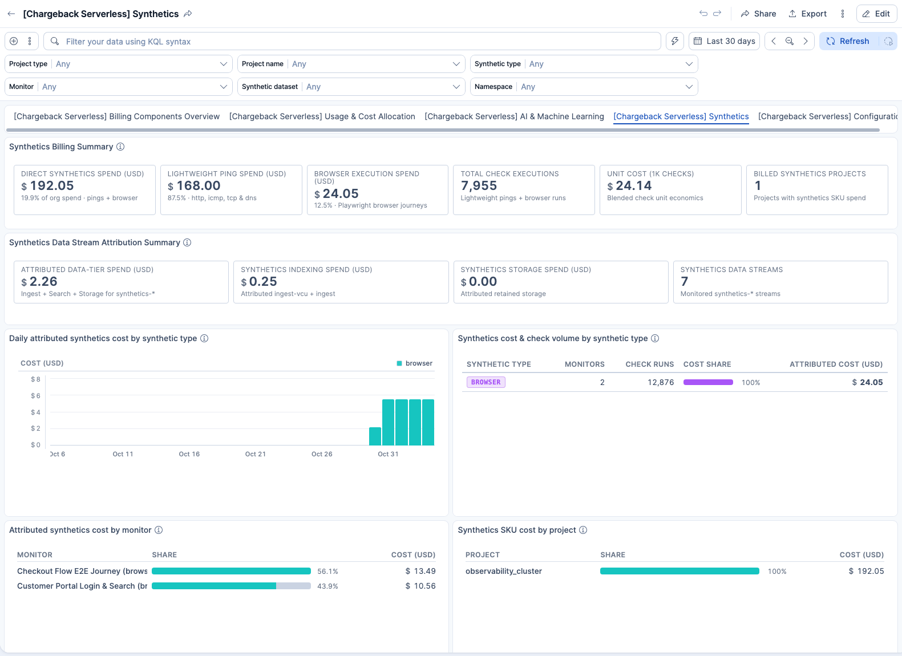
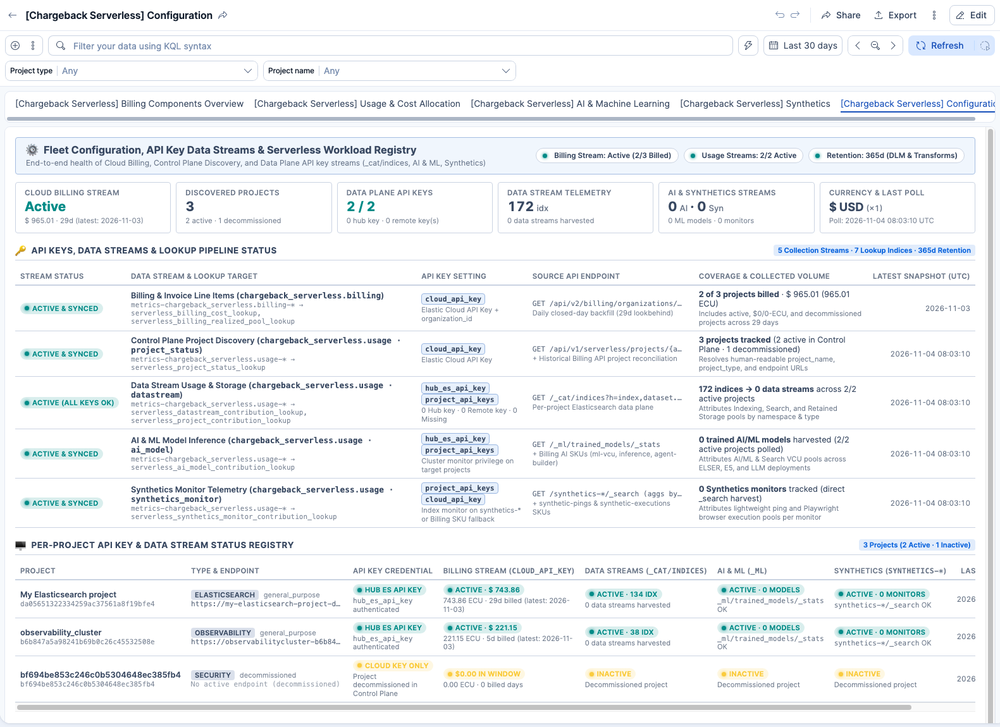

# Chargeback Serverless (native hub)

Native Chargeback for **Serverless-only** organizations. Runs on a Serverless hub project (recommended: Observability Complete). Collects billing and usage through native Elastic Agent CEL streams and Fleet transforms. No CCS, no CPS, no ESS Billing package, no `.monitoring-es-*` emulation, and no Kibana Workflows required.

The Fleet package source lives in the integrations repository (`packages/chargeback_serverless` on branch `wip-johannes-chargeback-serverless`), and built artifacts are stored in `dist/`.

## Install

```bash
./scripts/deploy_chargeback_serverless.sh
```

See [Instructions.md](Instructions.md) and [CONFIG.md](CONFIG.md) for full setup and configuration details.

## Assets

| Path | Description |
| --- | --- |
| `dist/chargeback_serverless-0.3.15.zip` | Built Fleet integration package archive (`0.3.15`) |
| `img/` | High-resolution dashboard screenshots (Billing Overview, Usage Allocation, AI & ML FinOps, Synthetics FinOps, Configuration) |
| `kibana/` | Kibana dashboards (exported via `elastic-package export dashboards`), alerting rule templates, and index pattern |
| `CONFIG.md` | Fleet policy configuration reference and remote project API key guide |
| `Instructions.md` | End-to-end installation and verification guide |

## Dashboards

The package includes five linked Kibana dashboards:

1. **[Chargeback Serverless] Billing Components Overview**
   Organization spend reconciliation, daily cost by project and cost category, spend flow (`cost_category → cost_type → project_type`), pass-through charges, and line-item invoice reconciliation.
   

2. **[Chargeback Serverless] Usage & Cost Allocation**
   Workload driver cost attribution (Indexing, Search & Query, Storage, AI & ML, Synthetics), per-project allocation breakdown, namespace and data stream type attribution, and harvested index metrics.
   

3. **[Chargeback Serverless] AI & Machine Learning**
   AI & ML FinOps metrics (AI pool spend, inference volume, active models, avg latency, unit cost per 1k inferences), daily attributed AI cost by model and project, and compute allocation breakdown.
   

4. **[Chargeback Serverless] Synthetics**
   Synthetics FinOps metrics (direct SKU spend, lightweight pings vs browser journeys, total check runs, unit cost per 1k checks), data stream tier attribution, and per-monitor cost attribution table with synthetic type filters.
   

5. **[Chargeback Serverless] Configuration**
   Fleet policy settings guide, active currency rates, Cloud Control Plane project discovery status, per-project API key status registry, and continuous harvest health.
   

## Related

- Hosted monitoring cluster + Serverless sources: [`../serverless/`](../serverless/) (existing add-on)
- Tracking: [elasticsearch-chargeback#123](https://github.com/elastic/elasticsearch-chargeback/issues/123)

