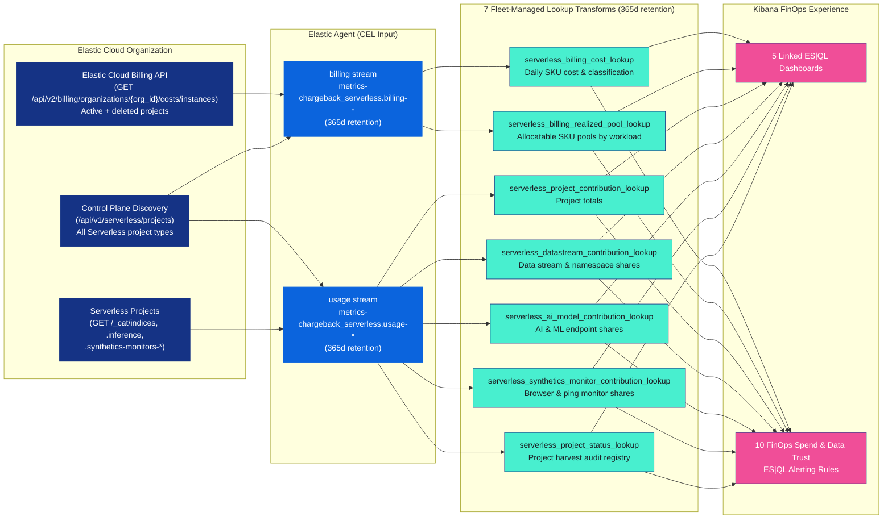

# Chargeback Serverless integration overview

The Chargeback Serverless integration (`chargeback_serverless` `0.4.1`) provides native FinOps cost attribution and workload showback for **Elastic Cloud Serverless** organizations—without requiring a dedicated Elastic Cloud Hosted monitoring cluster. Running directly on a Serverless FinOps hub project through a Fleet-managed Elastic Agent (or the standalone Python backfill collector), the integration uses a single unified Elastic Cloud API key to collect organization-wide Serverless billing history (including deleted projects) and per-project data stream, index, AI model, and Synthetics telemetry.

## Quick start: Customer Installation vs. Developer Workflows

- **For Customers & FinOps Operators (Kibana Fleet UI — no `elastic/integrations` checkout required)**:
  1. Pre-create the lookup index templates in Kibana Dev Tools (`"index.mode": "lookup"`), upload the prebuilt package [`assets/dist/chargeback_serverless-0.4.1.zip`](assets/dist/chargeback_serverless-0.4.1.zip) in Kibana (**Management → Integrations → Upload integration**), and attach it to a dedicated **`Chargeback Serverless Policy`**.
  2. *(Optional)* Run [`python3 scripts/run_chargeback_serverless_collector.py`](../../scripts/run_chargeback_serverless_collector.py) to immediately backfill historical per-project usage telemetry alongside the 60-day billing lookbehind.
  3. See **Part 1** of [Install and configure Chargeback Serverless](Instructions.md) for step-by-step instructions.
- **For Developers & Maintainers (Automated CLI Deployment)**:
  - Run [`./scripts/deploy_chargeback_serverless.sh`](../../scripts/deploy_chargeback_serverless.sh) from a Python `venv` (`pip install pyyaml`) to automate lookup template creation, package upload, transform provisioning, policy creation, historical backfill, and E2E verification.
  - The `elastic/integrations` repository is required **only** when editing package source templates under `packages/chargeback_serverless` and running `./scripts/deploy_chargeback_serverless.sh --build`.

## How Chargeback Serverless works

Chargeback Serverless collects billing and usage telemetry once per day after `02:00 UTC` for completed calendar days up to yesterday (`D-1` UTC), enriches the records through seven Fleet-managed Elasticsearch transforms into `LOOKUP`-mode indices, and visualizes costs across five linked Kibana dashboards using Elasticsearch Query Language (ES|QL) `LOOKUP JOIN` queries.

### Key capabilities

- **Single unified Elastic Cloud API key (`cloud_api_key`)**: One API key configured with Organization role **`Billing Admin`** and **Cloud resource access** (`Cloud, Elasticsearch, and Kibana API`) across `Elasticsearch`, `Observability`, and `Security` project types collects organization-wide Serverless billing history (including deleted projects via `GET /api/v2/billing/organizations/{org_id}/costs/instances`), dynamically discovers all active Serverless projects (`elasticsearch`, `observability`, `security`, and future project types), and harvests usage telemetry (`GET /_cat/indices`, `_ml/trained_models/_stats`, `_inference`, and `.ds-synthetics-*`) from each project.
- **Serverless-only billing focus**: Automatically filters out Elastic Cloud Hosted (ECH) deployment SKUs (`Cloud-Enterprise_*`, `.es.datahot`, etc.) so decommissioned or parallel Hosted clusters do not skew Serverless cost allocation into unallocatable `other` spend.
- **Exact SKU-to-workload pool reconciliation**: Unlike Hosted clusters that blend indexing, querying, and storage across shared node hardware, Elastic Cloud Serverless bills separate Stock Keeping Units (SKUs) for each resource driver:
  - **Indexing pool (`ingest-vcu` SKUs)**: Allocated across data streams and indices proportionally by indexing time (`indexing.index_time` harvested from `GET /_cat/indices`), with proportional fallback to storage size (`store_size_bytes` / `dataset.size`) when indexing time is zero.
  - **Search and query pool (`search-vcu` SKUs)**: Allocated across data streams and indices proportionally by query execution time (`search.query_time` harvested from `GET /_cat/indices`), with proportional fallback to storage size (`store_size_bytes` / `dataset.size`) when query time is zero.
  - **Storage pool (`retained` SKUs)**: Allocated across data streams and indices by daily `store_size_bytes`.
  - **AI and Machine Learning pool (`ml-vcu` and inference SKUs)**: Allocated across `.inference` endpoints and models in `serverless_ai_model_contribution_lookup` (attributing dedicated `ai_ecu * rate` for projects with dedicated AI SKUs, with an explicitly badged shared `search-vcu` fallback only when `ai_ecu == 0` and model inferences are active).
  - **Synthetics pools (`observability-synthetic-executions` and `observability-synthetic-pings` SKUs)**: Allocated across `browser` monitors (`synthetics_executions_ecu`) and lightweight (`http`, `icmp`, `tcp`, `dns`) monitors (`synthetics_pings_ecu`) in `serverless_synthetics_monitor_contribution_lookup`, with independent sub-pool fallback (`billing-derived-browser` and `billing-derived-lightweight`).

> [!NOTE]
> Telemetry metrics from `GET /_cat/indices` (`indexing.index_time`, `search.query_time`) and `_ml/trained_models/_stats` (`inference_count`) are cumulative lifetime counters per backing index or model. Allocating daily VCU pools by each data stream's relative share of these counters cancels out snapshot frequency and avoids negative deltas. If indexing or query time across a project is zero, dashboards automatically fall back to proportional storage allocation (`dataset.size`).

- **Automatic 365-day retention**: Both raw metrics data streams (`metrics-chargeback_serverless.billing-*` and `metrics-chargeback_serverless.usage-*`) and all seven lookup transforms enforce a 365-day retention policy (`data_retention: "365d"` and `retention_policy.time.max_age: 365d`).
- **Zero plaintext secret indices**: All credentials reside exclusively in the encrypted Kibana Fleet integration policy (`secret: true`). No API keys are stored in Elasticsearch indices.

## Dashboards

The package installs five linked Kibana dashboards with a shared top navigation bar:

| Dashboard title | Purpose |
| --- | --- |
| **`[Chargeback Serverless] Billing Components Overview`** | Reconciles your organization's full Elastic Cloud invoice across active and deleted projects, SKU line items, cost categories, and allocatable versus unallocatable spend. |
| **`[Chargeback Serverless] Usage & Cost Allocation`** | Attributes Indexing, Query, Storage, AI, and Synthetics SKU pools across projects, data stream types (`ds_type`), datasets (`ds_dataset`), namespaces (`ds_namespace`), and individual data streams/indices. |
| **`[Chargeback Serverless] AI & Machine Learning`** | Breaks down AI and Machine Learning (ML) Virtual Compute Unit (VCU) consumption by project, task type, model provider, and `.inference` endpoint. |
| **`[Chargeback Serverless] Synthetics`** | Tracks Synthetics spend and check volume by monitor type (`browser`, `http`, `icmp`, `tcp`, `dns`), monitor name, namespace, and project. |
| **`[Chargeback Serverless] Configuration`** | Displays active currency settings configured in the Fleet policy, step-by-step setup documentation, and the live project harvest audit registry (`serverless_project_status_lookup`). |

## Prebuilt FinOps alerting rules

Chargeback Serverless includes 4 ES|QL alerting rule templates in [`assets/kibana/alerting_rule_template/`](assets/kibana/alerting_rule_template/) with second-line `EVAL` threshold and filter variables that you can instantiate in Kibana (**Stack Management → Rules → Create rule**, searching for `[Chargeback Serverless]`):

1. **`[Chargeback Serverless] Rolling 30-day total spend budget exceeded`**: Alerts when cumulative 30-day organization spend reaches the budget watermark `threshold_pct` (default `80.0%` of `threshold_budget = 25000.0`) or when `alert_on_projected` (`true`) detects a projected 30-day overrun after at least 3 billed days.
2. **`[Chargeback Serverless] Project daily spend threshold exceeded`**: Alerts when any single project matching `filter_project` and optional `filter_driver` (`indexing`, `search`, `storage`, `ai`, `synthetics`) exceeds `threshold_spend` (default `200.0`), reporting the per-driver spend breakdown.
3. **`[Chargeback Serverless] Project daily spend spike vs. 7-day baseline`**: Alerts when a project's daily spend increases by more than `threshold_pct_increase` (default `50.0%`) over its 7-day baseline and exceeds `min_daily_spend` (default `25.0`).
4. **`[Chargeback Serverless] Data trust & project harvest health issue`**: Alerts when any discovered Serverless project fails usage harvesting (`last_status != "ok"`) or unallocated spend exceeds `threshold_unallocated_spend` (default `100.0`) and `threshold_unallocated_pct` (default `25.0%`).

## Package assets in this directory

| Path | Description |
| --- | --- |
| [`assets/dist/chargeback_serverless-0.4.1.zip`](assets/dist/chargeback_serverless-0.4.1.zip) | Prebuilt Fleet integration package ready to upload in Kibana (**Management → Integrations → Upload integration**). |
| [`Instructions.md`](Instructions.md) | Step-by-step customer installation guide (Kibana Fleet UI) and developer/maintainer automated deployment reference. |
| [`CONFIG.md`](CONFIG.md) | Reference for Fleet policy settings, currency conversion configuration, and alerting thresholds. |
| [`dashboards/DESIGN.md`](dashboards/DESIGN.md) | Detailed design reference for the five dashboards, filter controls, lookup indices, data classification rules, and 4 alerting rule templates. |
| [`assets/kibana/dashboard/`](assets/kibana/dashboard/) | Saved object JSON definitions for all five Chargeback Serverless dashboards. |
| [`assets/kibana/alerting_rule_template/`](assets/kibana/alerting_rule_template/) | 4 ES|QL FinOps spend and data-trust alerting rule template definitions. |

## Next steps

- Follow [Install and configure Chargeback Serverless](Instructions.md) to create your unified Elastic Cloud API key and deploy the integration.
- Review the [Configuration reference](CONFIG.md) to customize currency rates and alerting thresholds.
