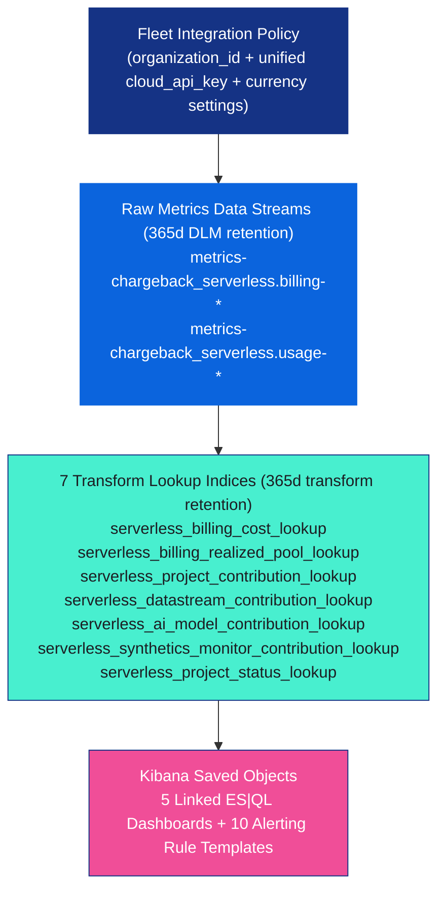

# Chargeback Serverless dashboard and alert design (`0.4.0`)

This reference documents the architecture, lookup index dependencies, data stream and index classification rules, pool fallback logic, filter controls, and Elasticsearch Query Language (ES|QL) alerting rule templates for the **Chargeback Serverless (`chargeback_serverless` `0.4.0`)** Kibana assets.

## Architecture overview

Chargeback Serverless runs on an Elastic Cloud Serverless FinOps hub project. A single unified Elastic Cloud API key (`cloud_api_key` with **Billing Admin** and **Cloud resource access** set to **`Cloud, Elasticsearch, and Kibana API`**) is stored in the Fleet integration policy. Daily collection runs through native Elastic Agent Common Expression Language (CEL) streams (`metrics-chargeback_serverless.billing-default` and `metrics-chargeback_serverless.usage-default`) and aggregates into seven Fleet-managed `LOOKUP`-mode indices with 365-day data retention.



## Dashboards

All five dashboards share a top horizontal navigation bar (`useCurrentDateRange: true`, `useCurrentFilters: true`) and default to a `now-30d` to `now` time window.

| Dashboard title | Saved object ID | Purpose |
| --- | --- | --- |
| **`[Chargeback Serverless] Billing Components Overview`** | `chargeback_serverless-b6cecac0-ebe7-43de-bfc6-1ff287ad860a` | Displays organization spend key performance indicators (KPIs), daily stacked cost by project (including active and deleted projects) and cost category, spend flow (`cost_category` → `cost_type` → `project_type`), unallocatable and pass-through charges, and invoice line-item reconciliation. |
| **`[Chargeback Serverless] Usage & Cost Allocation`** | `chargeback_serverless-21588d0e-fb6a-4f76-ad2f-cd7b3d7a3d7c` | Provides collapsible sections for (1) Workload drivers and project allocation and (2) Data stream and index cost attribution and usage across `ds_namespace`, `ds_type`, `ds_dataset`, and data streams/indices. |
| **`[Chargeback Serverless] AI & Machine Learning`** | `chargeback_serverless-5fb3f4c6-5591-5c5c-9625-1d829944c5b2` | Tracks AI and Machine Learning (ML) FinOps KPIs (AI pool spend, inference volume, active models, average latency, unit cost per 1,000 inferences), daily attributed AI cost by model and project, and dedicated AI, Inference, and Agent Builder Stock Keeping Unit (SKU) line items. |
| **`[Chargeback Serverless] Synthetics`** | `chargeback_serverless-c188156b-9f97-5e72-975f-022f3c862a1d` | Attributes direct Synthetics SKU spend (`observability-synthetic-executions` and `observability-synthetic-pings`) across `browser` and lightweight (`http`, `icmp`, `tcp`, `dns`) monitors, plus `synthetics-*` data stream indexing, search, and storage costs. |
| **`[Chargeback Serverless] Configuration`** | `chargeback_serverless-7ec9743a-ccfa-43d2-8311-2f25893dadae` | Presents the unified Fleet configuration status banner, five summary KPIs, the 3-step setup guide for the single unified Elastic Cloud API key, active policy currency settings, and the paginated project harvest registry. |

### Dashboard controls and filters

Shared controls (`project_type`, `project_name`, `allocation_driver`, `ds_namespace`) use deterministic UUIDs across dashboards so filter selections carry over when navigating between views:

| Dashboard | Controls (`controlGroupInput`) |
| --- | --- |
| **Billing Components Overview** | `project_type`, `project_name`, `cost_category`, `cost_type`, `allocation_driver` |
| **Usage & Cost Allocation** | `project_type`, `project_name`, `allocation_driver` (Workload driver), `ds_namespace` (Namespace), `ds_type` (Data stream type) |
| **AI & Machine Learning** | `project_type`, `project_name`, `model_id` (AI model), `task_type` (Task type) |
| **Synthetics** | `project_type`, `project_name`, `monitor_type` (Synthetic type), `monitor_id` (Monitor), `ds_dataset` (Synthetic dataset), `ds_namespace` (Namespace) |
| **Configuration** | `project_type`, `project_name` |

## Lookup indices and data sources

| Lookup index | Source data stream or index | Grouping key (`group_by`) | Retention | Purpose |
| --- | --- | --- | --- | --- |
| `serverless_billing_cost_lookup` | `metrics-chargeback_serverless.billing-*` | `@timestamp` (`1d`), `project_id`, `sku` | `365d` | Daily billed Elastic Consumption Units (ECU) and quantity per project and SKU, classified by `cost_category`, `cost_type`, `allocation_driver`, and `is_allocatable`. |
| `serverless_billing_realized_pool_lookup` | `serverless_billing_cost_lookup` | `@timestamp` (`1d`), `project_id` | `365d` | Daily allocatable ECU pools (`indexing_ecu`, `query_ecu`, `storage_ecu`, `ai_ecu`, `synthetics_ecu`, `synthetics_pings_ecu`, `synthetics_executions_ecu`) per project with `composite_key` (`YYYY-MM-DD_project_id`). |
| `serverless_datastream_contribution_lookup` | `metrics-chargeback_serverless.usage-*` (`doc_type: datastream`) | `@timestamp` (`1d`), `project_id`, `datastream` | `365d` | Daily indexing bytes/time, query time, and dataset size per data stream or index, parsed into `ds_type`, `ds_dataset`, and `ds_namespace`. |
| `serverless_project_contribution_lookup` | `serverless_datastream_contribution_lookup` | `@timestamp` (`1d`), `project_id` | `365d` | Daily project-wide denominator totals (`deployment_sum_indexing_time`, `deployment_sum_query_time`, `deployment_sum_data_set_store_size`) for `LOOKUP JOIN` attribution. |
| `serverless_ai_model_contribution_lookup` | `metrics-chargeback_serverless.usage-*` (`doc_type: ai_model`) | `@timestamp` (`1d`), `project_id`, `model_id`, `task_type` | `365d` | Daily AI and ML model inference count, latency, and total compute time. |
| `serverless_synthetics_monitor_contribution_lookup` | `metrics-chargeback_serverless.usage-*` (`doc_type: synthetics_monitor`) | `@timestamp` (`1d`), `project_id`, `monitor_id`, `monitor_type` | `365d` | Daily Synthetics monitor check count, availability (`up_count`, `down_count`), average duration, and location count. |
| `serverless_project_status_lookup` | `metrics-chargeback_serverless.usage-*` (`doc_type: project_status`) | `@timestamp` (`1d`), `project_id` | `365d` | Daily project discovery and harvest health status (`last_status`: `ok`, `empty_or_unauthorized`, `inactive`; `api_key_type`: `cloud_key`, `hub_key`, `remote_key`). |

## Data stream & index classification rules

When the usage collector (`metrics-chargeback_serverless.usage-*` and `run_chargeback_serverless_collector.py`) harvests index stats via `GET /_cat/indices`, backing indices are normalized into `datastream`, `ds_type`, `ds_dataset`, and `ds_namespace` using three deterministic classification rules:

1. **System data streams (`.ds-.kibana*`, `.ds-.alerts*`, `.ds-.fleet*`, and other dot-prefixed backing streams `.ds-.*`)**:
   - Strip `.ds-` and the trailing generation/date suffix (for example, `.ds-.kibana-event-log-serverless-2026.04.01-000001` → `.kibana-event-log-serverless`).
   - Classified as:
     - `ds_type = "system"`
     - `ds_namespace = "system"`
     - `ds_dataset = "<stream_name>"` (leading dot stripped)
2. **Standard Elastic data streams (`.ds-logs-*`, `.ds-metrics-*`, `.ds-traces-*`, `.ds-synthetics-*`, `.ds-profiling-*`)**:
   - Strip `.ds-` and the trailing generation/date suffix to recover `<type>-<dataset>-<namespace>`.
   - Classified as:
     - `ds_type = "<type>"` (`logs`, `metrics`, `traces`, `synthetics`, `profiling`)
     - `ds_dataset = "<dataset>"`
     - `ds_namespace = "<namespace>"`
3. **Standard Elasticsearch indices (non-data-stream indices such as `product-catalog-docs`, `financial-reports`, `search-products`)**:
   - Non-hidden indices that do not start with `.ds-` are preserved as standalone Elasticsearch indices rather than force-split on hyphens.
   - Classified as:
     - `ds_type = "index"`
     - `ds_dataset = "<index_name>"`
     - `ds_namespace = "default"`

## AI & ML and Synthetics pool fallback behavior

### AI & Machine Learning pool attribution (`ai_ecu` vs. shared `search-vcu` fallback)

- **Projects with dedicated AI SKUs (`ai_ecu > 0`)**: When a project incurs dedicated AI/ML billing SKUs (`ml-vcu`, `inference`, `agent-builder`), the AI & Machine Learning dashboard and model attribution panels allocate **strictly** the dedicated AI pool (`ai_ecu * conf_chargeable_unit_rate`) across models proportionally by `total_inference_time_ms` (falling back to `inference_count`). Shared `search-vcu` (`query_ecu`) is **never** added on top of dedicated `ai_ecu`.
- **Shared `search-vcu` fallback (`ai_ecu == 0` with active model inferences)**: On general-purpose Elasticsearch Serverless projects where built-in ELSER or vector embedding models run inside shared Search/Query compute without a separate `ml-vcu` SKU (`ai_ecu == 0` and `inference_count > 0`), attribution falls back to `query_ecu * conf_chargeable_unit_rate` and explicitly badges the allocation source (`Dedicated AI SKUs` vs. `Shared Search VCU Fallback`) so operators know whether spend comes from dedicated AI SKUs or shared query compute.

### Synthetics independent sub-pool fallback (`synthetics_pings_ecu` and `synthetics_executions_ecu`)

Elastic Cloud Serverless bills Synthetics via two independent SKU pools in `serverless_billing_realized_pool_lookup`:
- **`synthetics_pings_ecu`**: Lightweight monitor pings (`*synthetic*ping*` SKUs, covering `http`, `icmp`, `tcp`, and `dns` monitors).
- **`synthetics_executions_ecu`**: Browser monitor executions (`*synthetic*execution*` SKUs, covering `browser` monitors).
- **`synthetics_ecu`**: Total Synthetics ECU (`synthetics_pings_ecu + synthetics_executions_ecu`).

When `.ds-synthetics-*` telemetry is harvested from a project, lightweight monitors share `synthetics_pings_ecu` and browser monitors share `synthetics_executions_ecu`. If a project has billed Synthetics SKUs for either sub-pool on a given day where direct `.ds-synthetics-*` documents were not present for that sub-pool (for example, `synthetics_pings_ecu > 0` with zero harvested lightweight monitors, or `synthetics_executions_ecu > 0` with zero harvested browser monitors), the collector synthesizes an independent fallback monitor entry (`billing-derived-lightweight` and/or `billing-derived-browser`) so 100% of both `synthetics_pings_ecu` and `synthetics_executions_ecu` is reconciled on the Synthetics dashboard.

## ES|QL alerting rule templates

The generator builds 10 ES|QL alerting rule templates in [`../assets/kibana/alerting_rule_template/`](../assets/kibana/alerting_rule_template/):

- **Line-2 `EVAL` parameter convention**: Every alert defines its tunable thresholds (`threshold_spend`, `threshold_budget`, `threshold_pct_increase`, `threshold_unallocated_spend`) and entity filters (`filter_category`, `filter_driver`, `filter_project`, `filter_namespace`, `filter_model`, `filter_monitor`) on **line 2** immediately after `FROM <lookup_index>`, before `LOOKUP JOIN` and currency conversion logic.
- **Latest completed billing day scoping**: Single-day rules query a `3d` window (to accommodate Elastic Cloud Billing API latency) and filter to the latest completed billing day via `| INLINE STATS latest_day = MAX(@timestamp) | WHERE @timestamp == latest_day`.
- **Structured row output**: Each rule finishes with `| KEEP result, ...` to preserve both the human-readable `result` summary and structured columns (`day`, `spend`, `ecu`, `threshold`, `unit`) for action connectors.

| Alert template ID | Rule title | Window | Source lookup index | Line-2 `EVAL` defaults |
| --- | --- | --- | --- | --- |
| `chargeback_serverless-alert-total-daily-spend` | `[Chargeback Serverless] Total daily spend threshold exceeded` | `3d` | `serverless_billing_cost_lookup` | `threshold_spend = 1000.0` |
| `chargeback_serverless-alert-total-monthly-spend` | `[Chargeback Serverless] Rolling 30-day total spend budget exceeded` | `30d` | `serverless_billing_cost_lookup` | `threshold_budget = 25000.0` |
| `chargeback_serverless-alert-category-spend` | `[Chargeback Serverless] Cost category daily spend threshold exceeded` | `3d` | `serverless_billing_cost_lookup` | `threshold_spend = 300.0, filter_category = "*"` |
| `chargeback_serverless-alert-workload-driver-spend` | `[Chargeback Serverless] Workload driver daily spend threshold exceeded` | `3d` | `serverless_billing_cost_lookup` | `threshold_spend = 250.0, filter_driver = "*"` |
| `chargeback_serverless-alert-project-spend` | `[Chargeback Serverless] Project daily spend threshold exceeded` | `3d` | `serverless_billing_cost_lookup` | `threshold_spend = 200.0, filter_project = "*"` |
| `chargeback_serverless-alert-project-spend-spike` | `[Chargeback Serverless] Project daily spend spike vs. 7-day baseline` | `10d` | `serverless_billing_cost_lookup` | `threshold_pct_increase = 50.0, min_daily_spend = 25.0, filter_project = "*"` |
| `chargeback_serverless-alert-namespace-spend` | `[Chargeback Serverless] Namespace attributed daily spend threshold exceeded` | `3d` | `serverless_datastream_contribution_lookup` | `threshold_spend = 100.0, filter_namespace = "*"` |
| `chargeback_serverless-alert-ai-model-spend` | `[Chargeback Serverless] AI model attributed daily spend threshold exceeded` | `3d` | `serverless_ai_model_contribution_lookup` | `threshold_spend = 50.0, filter_model = "*"` |
| `chargeback_serverless-alert-synthetics-monitor-spend` | `[Chargeback Serverless] Synthetics monitor attributed daily spend threshold exceeded` | `3d` | `serverless_synthetics_monitor_contribution_lookup` | `threshold_spend = 25.0, filter_monitor = "*"` |
| `chargeback_serverless-alert-data-trust-health` | `[Chargeback Serverless] Data trust & project harvest health issue` | `3d` | `serverless_billing_cost_lookup` | `threshold_unallocated_spend = 100.0, threshold_unallocated_pct = 25.0` |

## Regenerate saved objects

To regenerate all Kibana saved objects (`dashboard/`, `alerting_rule_template/`, `index_pattern/`) from the repository root, run:

```bash
python3 scripts/generate_dashboards.py
```

## Related pages

- [Chargeback Serverless overview](../README.md)
- [Install and configure Chargeback Serverless](../Instructions.md)
- [Chargeback Serverless configuration reference](../CONFIG.md)
