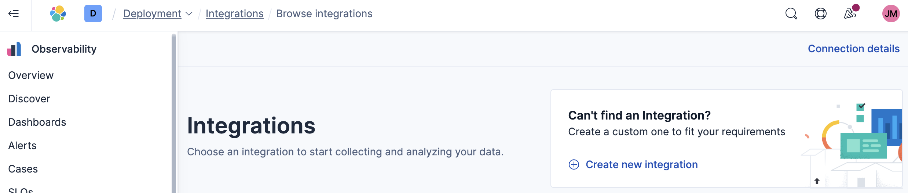
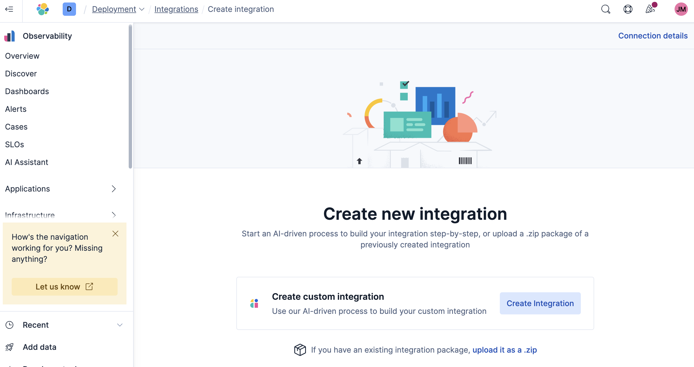

# Chargeback (ES|QL Version) Integration

This document outlines the steps to install the Chargeback integration, which makes use of the smart `ES|QL LOOKUP JOIN` feature (conditional joins) requiring Stack version 9.2.0+.

## Migrate from "module" to integration

If you have already installed the Chargeback "module" and want to rather use the integration, please follow the [Decommissioning](../module/Decommissioning.md) instructions of the module, and then return to these instructions.

## Setup Instructions

To install the Chargeback integration, please follow these steps:

### 1. Meet Prerequisites

See [Requirements](README.md#requirements) for details.

- **Self-contained mode (`0.6.0+`, recommended):** Upload `chargeback-0.6.0.zip` and add the **Chargeback** integration to a Fleet Agent policy (`chargeback.billing`, `chargeback.usage`, `chargeback.node_stats`). For self-managed / On-Premises clusters, also install **On-Premises Billing** (`metrics-ess_billing.billing-onprem*`) so `mERU` billing rows exist.
- **Coexistence / assets-only mode:** If relying on existing **ESS Billing** (or **On-Premises Billing**) and **Elasticsearch** (`index_pivot` + `node_stats`) policies without a Chargeback Agent policy, ensure at least one billing or monitoring backing index exists so `chargeback_lookup.chargeback_conf` materialises (dashboards apply default rates/weights automatically, or upsert custom values as shown below).

### 2. Upload ZIP File: 

- Asset: [`chargeback-0.6.0.zip`](assets/dist/0.6.0/chargeback-0.6.0.zip)
- Browse to Integrations, and click on `+ Create new integration`



- Upload the provided ZIP file by clicking on `upload it as a .zip`



### 3. Transforms Auto-Start & Fleet Policy Configuration

Starting from version 0.2.8, all Chargeback transforms are configured to auto-start upon installation.

In **v0.6.0**, rates and weights are configured directly in Kibana under **Management → Fleet → Agent Policies → Chargeback** (`sync_fleet_config: true` by default) and synced automatically into `chargeback_lookup.chargeback_conf` (`_id: config` for Elastic Cloud ECU and `_id: config_onprem` for On-Premises `mERU`):
- **Chargeable unit rate:** `0.85` `EUR` per Elastic Cloud ECU (`0.00085` `EUR` per On-Premises `mERU`)
- **Blended weights:** `indexing=20`, `query=20`, `storage=40`
- **Utilization weights & floor:** `memory=70`, `storage=30`, `floor=0.10`
- **Date range:** `2010-01-01` to `2046-12-31` (or bounded from `config_effective_from` when preserving historical rate periods)

On assets-only installations without a Chargeback Agent policy, dashboards fall back to these defaults automatically, or you can upsert custom configuration rows manually (see Configuration section below).

#### Credentials & API Keys by Scenario (`Elastic Cloud & Cluster Access`)

| Scenario | Billing Source | Usage & Node Stats Source | Required Credentials in Chargeback Policy |
|---|---|---|---|
| **Elastic Cloud Hosted (ECH) — Self-Contained (`0.6.0+`)** | `chargeback.billing` | `chargeback.usage` + `chargeback.node_stats` | `organization_id` + `cloud_api_key` (Billing Admin & deployment read) + `deployment_api_keys` (`<deployment_id_or_name>:<encoded_api_key>`); optionally `hub_es_url` + `hub_es_api_key` for the Hub cluster itself |
| **Elastic Cloud Serverless — Self-Contained (`0.6.0+`)** | `chargeback.billing` | `chargeback.usage` (`/_cat/indices`) | `organization_id` + `cloud_api_key` + `deployment_api_keys` (`<project_id_or_name>:<encoded_api_key>`) |
| **On-Premises / Self-Managed — Self-Contained CEL (`0.6.0+`)** | **On-Premises Billing** (`metrics-ess_billing.billing-onprem*`) | `chargeback.usage` + `chargeback.node_stats` | Leave `organization_id` & `cloud_api_key` blank; set `hub_es_url` + `hub_es_api_key` for the Hub cluster. For additional remote self-managed clusters, add one Chargeback policy per cluster with its `hub_es_url` + `hub_es_api_key` and `sync_fleet_config: false` on secondary policies |
| **Coexistence / Existing `Elasticsearch` Integration (ECH or On-Premises)** | **ESS Billing** or **On-Premises Billing** | **Elasticsearch** (`index_pivot` + `node_stats`), `metricbeat-*`, or `.monitoring-es-*` | **None** required on Chargeback (assets-only or billing-only mode reads existing `monitoring-indices*` and `node_stats` streams) |

To create a least-privilege Elasticsearch API key for `hub_es_api_key` or `deployment_api_keys` (no document `read` access required):

```json
POST /_security/api_key
{
  "name": "chargeback-usage-collector",
  "role_descriptors": {
    "chargeback_collector": {
      "cluster": ["monitor"],
      "indices": [
        {
          "names": ["*", ".*"],
          "privileges": ["monitor", "view_index_metadata"],
          "allow_restricted_indices": true
        }
      ]
    }
  }
}
```

Use the returned `encoded` field in `hub_es_api_key` (or as `<deployment_id_or_name>:<encoded>` in `deployment_api_keys`).

**Performance Note:** On clusters with months of historical monitoring data for multiple deployments, the initial transform execution may process a large volume of data. This can cause temporary performance impact during the first run. The transforms will then run incrementally on their configured schedules (15-60 minute intervals), processing only new data with minimal overhead.

### 4. Configure Alerting Rules (Optional)

Version 0.2.8 includes three pre-configured alerting rule templates:
- **Transform Health Monitoring** - Monitors transform health status
- **New Chargeback Group Detection** - Alerts on new chargeback group tags
- **Missing Usage Data** - Detects deployments with missing usage data

These rules can be configured in **Stack Management → Rules** after installation.

**Important:** For the New Chargeback Group Detection and Missing Usage Data alert rules, ensure that the Chargeback transforms are running before setting them up. These alerting rules query the lookup indices created by the transforms. If the transforms are not started, the alerts will not function correctly.

## Upgrade integration

To upgrade the integration, do the following:
- Upload the new asset (ZIP) file to Kibana.
- Transforms will auto-start (from version 0.2.8 onwards).

**Upgrading to 0.6.0:**
- Upload [`chargeback-0.6.0.zip`](assets/dist/0.6.0/chargeback-0.6.0.zip). Kibana requirement remains `9.2.0+`.
- Seven transforms (`billing_cluster_cost`, `billing_realized_pool`, `billing_credits`, `cluster_deployment_contribution`, `cluster_tier_contribution`, `cluster_datastream_contribution`, and `cluster_tier_and_ds_contribution`) now write to versioned `chargeback_lookup.dest_*-1` indices aliased as `chargeback_lookup.*`, backfilling retained history from `metrics-ess_billing.billing-*`, `metrics-ess_billing.credits-*`, `monitoring-indices*`, and `metrics-chargeback.*` automatically. If raw billing or monitoring streams have shorter ILM retention than your `0.5.0` `*_lookup` indices, reindex older daily rows before the earliest retained source timestamp into `chargeback_lookup.dest_*-1` (routing `billing_cluster_cost_lookup` rows through `"pipeline": "logs-chargeback.lookup-0.6.0-billing"`, setting `usage_source: "legacy"` on migrated usage rows, and setting `is_onprem: true` on migrated On-Premises `mERU` rows).
- On upgrade from `0.4.x` or `0.5.0`, `chargeback_conf_lookup` automatically carries over existing `chargeback_conf_lookup` custom rates, currency, weights, and date windows into `chargeback_lookup.chargeback_conf` (`_id: config`) when no Fleet `config_snapshot` exists. Before enabling `sync_fleet_config: true` on an installation with customized historical rate periods, copy your active rate and weights into the Fleet policy UI and set **Configuration Effective Start Date** (`config_effective_from`) to the start date of your current open-ended period (or set `sync_fleet_config: false`). On-Premises `mERU` rows read `config_join_key: "chargeback_config_onprem"` (`_id: config_onprem`, default `0.00085`). Run `./scripts/migrate_to_060.sh --dry-run` (then without `--dry-run`) after upgrading to verify all 8 `chargeback_lookup.*` aliases and delete retired pre-0.6.0 `*_lookup` indices to reclaim cluster shards.
- Transform destination custom pipeline hooks moved to `logs-chargeback.lookup@custom` and `logs-chargeback.lookup-<name>@custom`; migrate any lookup-only custom processors out of `metrics-chargeback.*@custom` before enabling native CEL streams.
- If you installed the optional **Chargeback companion agent**, re-run `./scripts/install_chargeback_agent.sh` so its ES|QL tools and `chargeback-cost-review` workflow query the `0.6.0` `chargeback_lookup.*` aliases.

**Upgrading to 0.5.0:**
- Upload [`chargeback-0.5.0.zip`](assets/dist/0.5.0/chargeback-0.5.0.zip). Adds Serverless allocatable pool SKUs, usage transforms on canonical `monitoring-indices*` only (Cloud Console via the Elasticsearch integration `index_pivot`; avoids double-counting raw `.monitoring-es-*`), tier-preference order matching `monitoring_indices.yml`, and keyword runtime fields for fielddata-safe aggregations. Kibana requirement remains 9.2.0+.
- For Serverless **usage** breakdown (not only billing), install the [Serverless add-on](addons/serverless-usage-collector/Instructions.md) after the zip.
- If you upgraded from 0.4.x and transforms stay on old definitions, confirm `fleet_transform_version` is `0.5.0` or reset and restart the affected transforms after upload.

**Upgrading to 0.4.7:**
- Prefer **0.5.0**. Or upload [`chargeback-0.4.7.zip`](assets/dist/0.4.7/chargeback-0.4.7.zip). Includes Fleet pipeline layout under `data_stream/lookup`, conf pipeline rename, and `cluster_capacity_utilization` runtime keyword for TEXT `elasticsearch.cluster.name` on legacy `.monitoring-es-8-mb-*` ([#117](https://github.com/elastic/elasticsearch-chargeback/issues/117)). Also includes 0.4.4–0.4.6 fixes (`config` document ID, keyword `composite_key`, tier-panel JOIN restructure). Kibana requirement remains 9.2.0+.
- **If you upgraded from 0.2.10–0.4.3** and already have a hashed-ID bootstrap row: after upgrade creates the `_id` `config` document, copy any customized values with `POST chargeback_conf_lookup/_update/config`, then delete the hashed-ID document so LOOKUP JOIN does not match two overlapping date windows. Do not index a partial document to ID `config` with the index API (`_doc`); that replaces the whole document and can drop required bootstrap fields such as `config_join_key`. Fresh 0.4.4+ installs need no cleanup.
- If `cluster_capacity_utilization` failed before upgrade on TEXT cluster names, reset and restart that transform after installing 0.4.7 so historical utilization rows backfill.

**Upgrading to 0.4.4:**
- Prefer **0.5.0** (or upload `chargeback-0.4.4.zip` only if you cannot take a newer asset). The bootstrap transform writes the default configuration document with `_id` `config`, so `POST chargeback_conf_lookup/_update/config` works as documented ([#110](https://github.com/elastic/elasticsearch-chargeback/issues/110)). Kibana requirement remains 9.2.0+.

**Upgrading to 0.4.3:**
- Upload `chargeback-0.4.3.zip` (or go directly to `0.5.0`). Replaces Billing and Usage dashboard saved objects that still used `COALESCE(..., conf_ecu_rate)` / `total_ecu` after 0.4.2 ([#104](https://github.com/elastic/elasticsearch-chargeback/issues/104)). No transform reset required. Kibana requirement remains 9.2.0+.

**Upgrading to 0.4.2:**
- Upload `chargeback-0.4.2.zip` (or go directly to `0.5.0`). Replaces dashboard saved objects that still referenced legacy `conf_ecu_rate*` columns on the Configuration dashboard or used bare `@timestamp` in `LOOKUP JOIN` ON clauses ([#104](https://github.com/elastic/elasticsearch-chargeback/issues/104), [#105](https://github.com/elastic/elasticsearch-chargeback/issues/105)). No transform reset required. Kibana requirement remains 9.2.0+.

**Upgrading to 0.4.1:**
- Upload `chargeback-0.4.1.zip` (or go directly to `0.5.0`). Usage transforms gain `ds_type` / `ds_namespace` and all lookups gain `event.ingested`. Reset usage transforms if you need historical rows enriched. Kibana requirement remains 9.2.0+.

**Upgrading from 0.3.x to 0.4.0:**
- Upload `chargeback-0.4.0.zip` (or go directly to `0.5.0`). Two new transforms (`billing_realized_pool`, `cluster_capacity_utilization`) are created and auto-started.
- The old `[Chargeback] Cost and Consumption breakdown` dashboard is replaced by three new dashboards (`[Chargeback] Billing Components Overview`, `[Chargeback] Usage & Cost Allocation`, and `[Chargeback] Configuration`). If Kibana does not replace the old dashboard automatically, delete it and re-import from **Saved Objects**.
- Reset and restart the `billing_cluster_cost` transform to backfill `cost_type`, `cost_category`, and `is_allocatable` into existing lookup documents. Until the backfill completes, "Cost by component (SKU)" panels will show no data.
- Ensure `node_stats` data is flowing into `metrics-elasticsearch.stack_monitoring.node_stats-*` for the utilization transform. Without this, `cluster_capacity_utilization_lookup` will be empty and utilization defaults to 100% (full provisioned cost charged to all tiers).
- New configuration fields are added to `chargeback_conf_lookup` with sensible defaults (utilization weights, floor, memory/storage cost split). Update via `POST chargeback_conf_lookup/_update/config` if you wish to customise them.

**Upgrading from 0.3.0 to 0.3.1:**
- No manual steps required for the `chargeback_conf_lookup` index - the bootstrap transform will automatically create it if it doesn't exist.
- If you previously manually created the `chargeback_conf_lookup` index, it will continue to work with the new version.

**Upgrading from 0.3.1 to 0.3.2:**
- Contribution transforms read usage data from `monitoring-indices*` and cross-cluster `*:monitoring-indices*` so a customized Elasticsearch integration index-pivot destination still matches when its name uses the `monitoring-indices*` prefix (default remains `monitoring-indices`).
- Fixes dashboard panels that failed with `Unknown column [total_ecu]` / `[conf_ecu_rate]` on 0.3.1 by shipping legacy ECU field aliases in lookup mappings. Existing 0.3.1 lookup indices must be recreated (delete + transform reset) to pick up the new mappings; restart alone does not update mappings. Delete and re-import the Chargeback dashboard saved objects if Kibana did not replace them—see [troubleshooting](docs/troubleshooting.md).

**Upgrading from 0.2.x to 0.3.0/0.3.1 (breaking change):**
- Field names have changed from ECU to chargeable units: `total_ecu` → `total_chargeable_units`, `conf_ecu_rate` → `conf_chargeable_unit_rate`, `conf_ecu_rate_unit` → `conf_chargeable_unit_rate_unit`. Existing lookup indices and config documents use the old schema; new data from the updated transforms will use the new schema. See [CHANGELOG](../CHANGELOG.md) and upgrade documentation for migration steps.

## Optional add-ons

Pure Chargeback is this Fleet package. Optional add-ons live under [`addons/`](addons/) and [`../../agents/`](../../agents/):

- **Serverless usage collector** — optional Kibana Workflow add-on for **0.5.0** or **0.6.0+** assets-only deployments without a Chargeback Elastic Agent policy (in **0.6.0+**, the built-in `chargeback.usage` CEL stream collects Serverless `/_cat/indices` usage natively). See [`addons/serverless-usage-collector/Instructions.md`](addons/serverless-usage-collector/Instructions.md) and [`scripts/install_serverless_usage.sh`](../../scripts/install_serverless_usage.sh).
- **Chargeback companion agent** — optional report and Q&A over `chargeback_lookup.*` indices (**0.6.0+**). See [`../../agents/companion-agent/Instructions.md`](../../agents/companion-agent/Instructions.md) and [`scripts/install_chargeback_agent.sh`](../../scripts/install_chargeback_agent.sh).

## Troubleshooting

If the dashboard is empty after install, see **[docs/troubleshooting.md](docs/troubleshooting.md)**.

## Configuration

In **v0.6.0**, configuration values (Cloud ECU rate, On-Premises `mERU` rate, currency unit, effective start date, blended weights, and utilization weights/floor) are managed directly in Kibana under **Management → Fleet → Agent Policies → Chargeback** (`sync_fleet_config: true`) and synced into `chargeback_conf_lookup` (`_id: config` for `chargeback_config` and `_id: config_onprem` for `chargeback_config_onprem`).

To manage `chargeback_conf_lookup` manually instead, set `sync_fleet_config: false` on your Chargeback Fleet policy (or run in assets-only mode) and upsert `_id: config` (and optionally `_id: config_onprem` for On-Premises `mERU`) with `"doc_as_upsert": true`:

```json
POST chargeback_conf_lookup/_update/config
{
  "doc": {
    "config_join_key": "chargeback_config",
    "conf_chargeable_unit_rate": 0.85,
    "conf_chargeable_unit_rate_unit": "EUR",
    "conf_indexing_weight": 20,
    "conf_query_weight": 20,
    "conf_storage_weight": 40,
    "conf_utilization_memory_weight": 70,
    "conf_utilization_storage_weight": 30,
    "conf_utilization_floor": 0.10,
    "conf_start_date": "2024-01-01T00:00:00.000Z",
    "conf_end_date": "2046-12-31T23:59:59.999Z"
  },
  "doc_as_upsert": true
}
```

### Add a new configuration period (for time-based rate changes):

Using `_doc` creates a new document with an auto-generated ID:

```
POST chargeback_conf_lookup/_doc
{
  "config_join_key": "chargeback_config",
  "conf_chargeable_unit_rate": 0.95,
  "conf_chargeable_unit_rate_unit": "EUR",
  "conf_indexing_weight": 20,
  "conf_query_weight": 20,
  "conf_storage_weight": 40,
  "conf_start_date": "2025-01-01T00:00:00.000Z",
  "conf_end_date": "2025-12-31T23:59:59.999Z"
}
```
