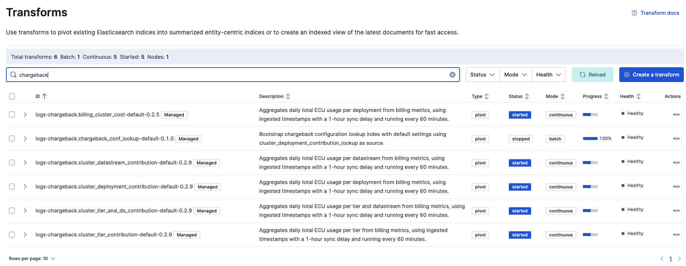
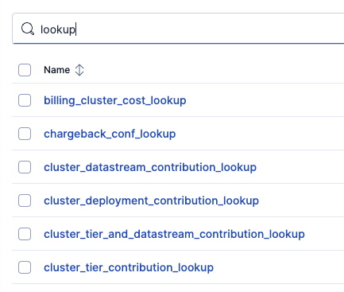
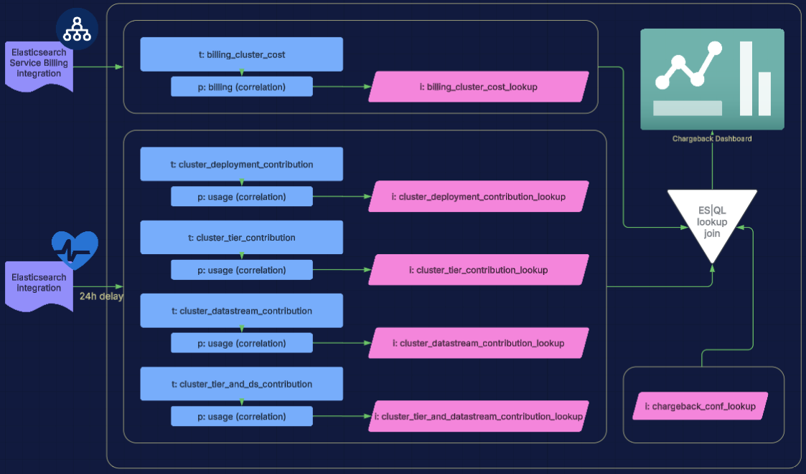
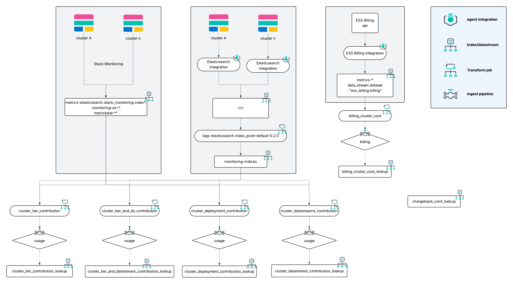
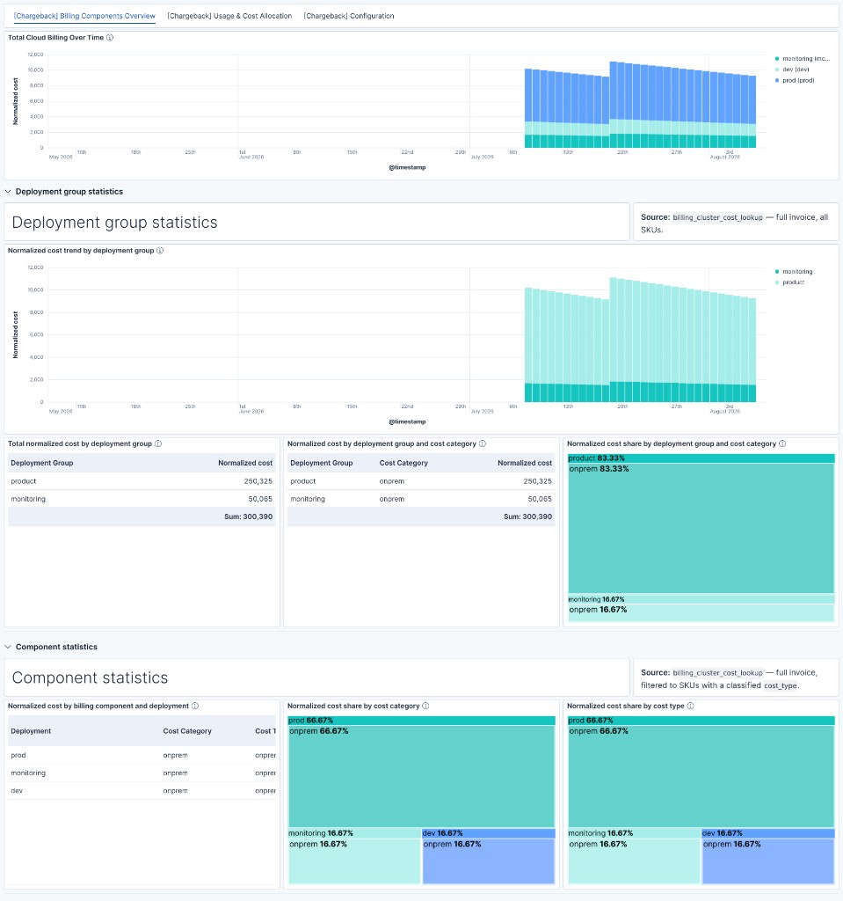
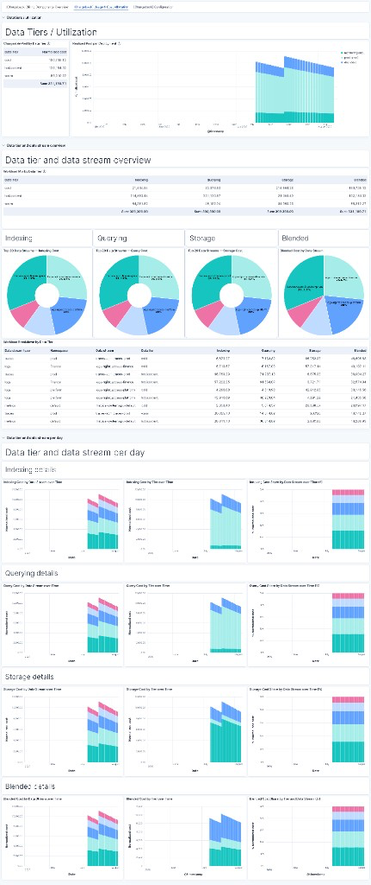
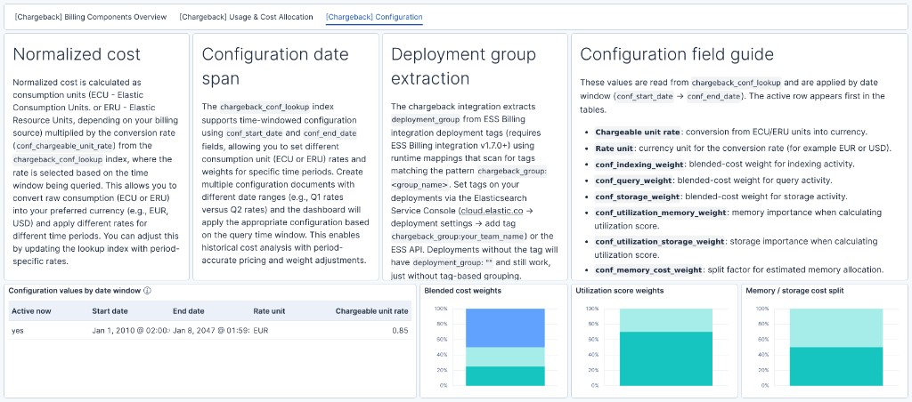

# Elasticsearch Chargeback integration

## Version

Chargeback integration: 0.6.0

## Dependencies

This integration runs on the **Monitoring cluster** (Hub), where billing and monitoring telemetry is collected.

### Requirements

To use this integration, the following prerequisites must be met:

- The monitoring cluster, where this integration is installed, must be on version **9.2.0+** due to its use of conditional [ES|QL LOOKUP JOIN](https://www.elastic.co/docs/reference/query-languages/esql/esql-lookup-join).
- **Option A — Self-contained Elastic Agent CEL collection (recommended in `0.6.0+`):** Run a Fleet-managed **Elastic Agent** with the **Chargeback** integration enabled (`chargeback.billing`, `chargeback.usage`, and `chargeback.node_stats`). No separate **ESS Billing** or **Elasticsearch** `index_pivot` policies are required for Elastic Cloud Hosted or Serverless environments. For **self-managed / On-Premises** clusters, also install **On-Premises Billing** (`metrics-ess_billing.billing-onprem*`) so `mERU` billing rows are available to allocate.
- **Option B — Coexistence / assets-only mode with existing producers:** Existing [**Elasticsearch Service Billing**](https://www.elastic.co/docs/reference/integrations/ess_billing/) (`v1.7.0+`, `metrics-ess_billing.billing-*`), **On-Premises Billing**, and [**Elasticsearch**](https://www.elastic.co/docs/reference/integrations/elasticsearch/) (`v1.16.0+` with `logs-elasticsearch.index_pivot-default-{VERSION}` started into `monitoring-indices*` and `node_stats` enabled) continue to work side by side without double-counting during mid-day cutover.

### Version compatibility

| Integration Version | Required Stack Version | ESS Billing Version | Notes |
|---------------------|------------------------|---------------------|-------|
| Up to 0.2.1 | 8.18.0+ | 1.4.1+ | Basic ES\|QL LOOKUP JOIN support |
| 0.2.2 - 0.2.9 | 9.2.0+ | 1.4.1+ | Requires smart lookup join (conditional joins) |
| 0.2.10 - 0.2.x | 9.2.0+ | 1.7.0+ | Requires ESS Billing 1.7.0 features |
| 0.3.0 | 9.2.0+ | 1.7.0+ | Chargeable units schema (breaking change from 0.2.x) |
| 0.3.1 - 0.3.2 | 9.2.0+ | 1.7.0+ | Field renames, deployment_tags fix, explicit lookup mappings |
| 0.4.0 | 9.2.0+ | 1.7.0+ | Realized cost model, SKU classification, three-dashboard split |
| 0.4.1 | 9.2.0+ | 1.7.0+ | `ds_type` / `ds_namespace` parse + Workload Breakdown columns; `event.ingested` on lookups |
| 0.4.2 | 9.2.0+ | 1.7.0+ | Dashboard ES\|QL fixes for Configuration legacy rate columns and ambiguous `@timestamp` LOOKUP JOIN |
| 0.4.3 | 9.2.0+ | 1.7.0+ | Dashboard ES\|QL: remove remaining `conf_ecu_rate` / `total_ecu` COALESCE fallbacks on Billing and Usage panels |
| 0.4.4 | 9.2.0+ | 1.7.0+ | Bootstrap transform writes `chargeback_conf_lookup` document ID `config` for `_update/config` |
| 0.4.5 | 9.2.0+ | 1.7.0+ | Map `composite_key` as keyword; dashboard LOOKUP JOIN uses `composite_key` (not `.keyword`) |
| 0.4.6 | 9.2.0+ | 1.7.0+ | Usage tier-cost panels: JOIN left side from `cluster_tier_contribution_lookup` for pre-0.4.5 text mappings |
| 0.4.7 | 9.2.0+ | 1.7.0+ | Fleet pipeline layout (`data_stream/lookup`); capacity utilization runtime keyword for TEXT cluster names |
| 0.5.0 | 9.2.0+ | 1.7.0+ | Serverless billing pool SKUs; canonical `monitoring-indices*` usage source; tier preference order; fielddata runtime fields |
| 0.6.0 | 9.2.0+ | Optional (built-in CEL or 1.7.0+) | Self-contained CEL streams (`billing`, `usage`, `node_stats`), versioned `chargeback_lookup.*` aliases, Fleet UI config sync + On-Prem `mERU` rate, opt-in stock dashboard compatibility |

## Setup instructions

Please see [Integration `Instructions.md`](Instructions.md) to install the integration and [Credentials & API Keys by Scenario](Instructions.md#credentials--api-keys-by-scenario-elastic-cloud--cluster-access) for ECH, Serverless, On-Premises (`hub_es_url` / `hub_es_api_key`), and coexistence setup.

## Troubleshooting

See [Instructions.md — Troubleshooting](Instructions.md#troubleshooting) and [docs/troubleshooting.md](docs/troubleshooting.md).

## Data flow

Chargeback processes billing, index/tier usage, and node utilization telemetry from built-in Elastic Agent CEL streams (`metrics-chargeback.billing-*`, `metrics-chargeback.usage-*`, `metrics-chargeback.node_stats-*`) and/or existing **ESS Billing**, **On-Premises Billing**, and **Elasticsearch** (`monitoring-indices*`, `node_stats`) streams through **nine** continuous transforms:

**Billing transforms:**
- `billing_cluster_cost` — total chargeable units (ECU / `mERU`) per deployment, per SKU, per day in `chargeback_lookup.dest_billing_cluster_cost-1` (aliased as `chargeback_lookup.billing_cluster_cost`). Includes `cost_type`, `cost_category`, `is_allocatable`, `is_onprem`, and ESS Billing compatibility fields.
- `billing_realized_pool` — allocatable data-tier capacity pool per deployment per day in `chargeback_lookup.dest_billing_realized_pool-1` (aliased as `chargeback_lookup.billing_realized_pool`).
- `billing_credits` — daily organisation credit commitment snapshots in `chargeback_lookup.dest_billing_credits-1` (aliased as `chargeback_lookup.billing_credits`) for the opt-in stock **[Metrics ESS Billing] Credits** dashboard alias.
- `chargeback_conf_lookup` — syncs Fleet policy `config_snapshot` events (`5m` frequency) into `chargeback_lookup.dest_chargeback_conf-1` (aliased as `chargeback_lookup.chargeback_conf`, `_id: config` for Cloud ECU and `_id: config_onprem` for On-Premises `mERU`) while automatically carrying over pre-0.6.0 `chargeback_conf_lookup` settings or preserving manual rows when Fleet sync is disabled.

**Utilization transforms:**
- `cluster_capacity_utilization` — p95 heap and disk utilization across data-role nodes per deployment per day in `cluster_capacity_utilization_lookup`.

**Usage transforms** (from `metrics-chargeback.usage-*` and `monitoring-indices*`):
- `cluster_deployment_contribution` — indexing, querying, and storage metrics per deployment per day in `chargeback_lookup.dest_cluster_deployment_contribution-1` (aliased as `chargeback_lookup.cluster_deployment_contribution`).
- `cluster_tier_contribution` — same metrics split by data tier in `chargeback_lookup.dest_cluster_tier_contribution-1` (aliased as `chargeback_lookup.cluster_tier_contribution`).
- `cluster_datastream_contribution` — same metrics split by data stream in `chargeback_lookup.dest_cluster_datastream_contribution-1` (aliased as `chargeback_lookup.cluster_datastream_contribution`); usage pipeline sets `ds_type` and `ds_namespace`.
- `cluster_tier_and_ds_contribution` — same metrics split by both tier and data stream in `chargeback_lookup.dest_cluster_tier_and_datastream_contribution-1` (aliased as `chargeback_lookup.cluster_tier_and_datastream_contribution`).

All lookup destination documents include ECS `event.ingested` (when the row was written).

All of the transforms create their own lookup index. There is also a lookup index for the configuration. Starting from version 0.2.8, all transforms are configured to auto-start upon installation. **Version 0.2.10 introduces automated creation of the `chargeback_conf_lookup` index via a bootstrap transform**, eliminating the need for manual index creation.

**Performance Note:** On clusters with months of historical monitoring data for multiple deployments, the initial transform execution may process a large volume of data. This can cause temporary performance impact during the first run. The transforms will then run incrementally on their configured schedules (15-60 minute intervals), processing only new data with minimal overhead.

To be able to take indexing, querying and storage into consideration in a weighted fashion, we use the following weights (see  [Integration `Instructions.md`](Instructions.md) on how to change these):
- indexing: 20 (only considered for the hot tier)
- querying: 20
- storage: 40

This means that storage will contribute the most to the blended cost calculation, and that indexing will only contribute to this blended cost on the hot tier. You should consider these weights, and adjust these based on your own best judgement. 

## Dashboards

The integration ships three focused dashboards with a navigation bar linking between them:

### [Chargeback] Billing Components Overview

Answers: *what did we spend and where did it go?*

- **Deployment group statistics** — total cost and trend per `chargeback_group` tag.
- **Component statistics** — cost by billing component (`cost_type`: datahot/datacontent, datawarm, datacold, transfer, snapshot, …) and FinOps category (`cost_category`), normalized to your configured currency rate.

### [Chargeback] Usage & Cost Allocation

Answers: *which data streams and tiers drive cost, and how efficiently are we using capacity?*

- **Data tiers / utilization** — provisioned capacity versus realized pool (`chargeable_pool = provisioned × util_score`), p95 heap and disk utilization.
- **Data tier and data stream overview** — top-20 data streams by indexing / query / storage cost, blended cost totals, and Workload Breakdown table columns for data stream type, namespace, data stream, and tier.
- **Data tier and data stream per day** — time-series cost breakdown (indexing, querying, storage, blended) by data stream and tier, including percentage share panels.

For shared deployments, assign each team a unique Fleet namespace so streams follow `<type>-<dataset>-<namespace>`. Chargeback parses those segments into the Workload Breakdown table. Interactive control-bar filters on `ds_*` are deferred to a later 0.5.x line.

### [Chargeback] Configuration

A standalone reference dashboard showing all active configuration values: conversion rate, date windows, blended cost weights, utilization score weights, and memory/storage cost split — each visualised as a percentage-stacked bar chart.

## Alerting Rules

Version 0.2.8 includes three pre-configured Kibana alerting rule templates to help monitor your Chargeback integration:

1. **Transform Health Monitoring** - Monitors the health status of all Chargeback transforms and alerts when issues are detected
2. **New Chargeback Group Detection** - Notifies when a new `chargeback_group` tag is added to a deployment
3. **Missing Usage Data** - Alerts when a deployment with a chargeback group assigned is not sending usage/consumption data

These alerting templates are automatically installed with the integration and can be configured through **Stack Management → Rules** in Kibana.

**Important:** For alert rules 2 and 3, ensure that the Chargeback transforms are running before setting them up. These alerting rules query the lookup aliases created by the transforms (`chargeback_lookup.billing_cluster_cost`, `chargeback_lookup.cluster_deployment_contribution`, etc.). If the transforms are not started, the alerts will not function correctly.

## Version 0.6.0 Release Notes

### Breaking changes

- Versioned `chargeback_lookup.*` lookup aliases (`chargeback_lookup.dest_*-1` aliased as `chargeback_lookup.billing_cluster_cost`, `chargeback_lookup.billing_realized_pool`, `chargeback_lookup.billing_credits`, `chargeback_lookup.cluster_deployment_contribution`, `chargeback_lookup.cluster_tier_contribution`, `chargeback_lookup.cluster_datastream_contribution`, and `chargeback_lookup.cluster_tier_and_datastream_contribution`) replace concrete `0.5.0` `*_lookup` names so in-place upgrades never collide with legacy mappings or stale `group_by` document IDs.
- Lookup destination custom pipeline hooks moved to `logs-chargeback.lookup@custom` and `logs-chargeback.lookup-<name>@custom` (separating them from raw `metrics-chargeback.*@custom` stream hooks).

### What's new

- Self-contained Elastic Agent CEL collection streams (`chargeback.billing`, `chargeback.usage`, and `chargeback.node_stats`) covering Elastic Cloud Hosted, Serverless (including `/_cat/indices` usage), and self-managed shard-placement tier and node utilization harvesting.
- Side-by-side coexistence with **ESS Billing**, **On-Premises Billing**, and **Elasticsearch** (`monitoring-indices*`, `node_stats`) without double-counting or mid-day cutover gaps.
- Fleet policy controls for currency, Cloud ECU rate (`unit_rate`), On-Premises `mERU` rate (`onprem_unit_rate` -> `_id: config_onprem`), effective UTC start date (`config_effective_from`), multi-policy `config_owner_id`, blended weights, and utilization weights/floor.
- Active-dimension blended cost normalisation (100% chargeable-pool conservation) and redesigned `[Chargeback] Configuration` dashboard with 72-hour freshness status and deployment harvest registry.
- Opt-in compatibility fields and aliases for stock **ESS Billing** (`metrics-ess_billing.billing-chargeback`, `metrics-ess_billing.credits-chargeback`) and **Elasticsearch Consumption** (`monitoring-indices`) dashboards.
- Companion Agent Builder ES|QL tools and `chargeback-cost-review` workflow (`../../agents/companion-agent/`) updated for `0.6.0` `chargeback_lookup.*` aliases and simultaneous Cloud ECU / On-Premises `mERU` rate joins.

### Upgrade notes

- Upload [`chargeback-0.6.0.zip`](assets/dist/0.6.0/chargeback-0.6.0.zip). Package version **0.6.0**; Kibana remains `^9.2.0`. See [Instructions.md — Upgrading to 0.6.0](Instructions.md#upgrade-integration).
- Integration source: [elastic/integrations#22427](https://github.com/elastic/integrations/pull/22427).

## Version 0.5.0 Release Notes

### What's new

- Serverless capacity SKUs in `billing_realized_pool` (search/ingest VCU, retained storage; ML VCU excluded).
- Usage transforms use canonical `monitoring-indices*` only (Cloud Console via Elasticsearch `index_pivot`; avoids double-counting raw `.monitoring-es-*`).
- Tier preference fallbacks use frozen → cold → warm → hot/content order.
- Keyword runtime fields avoid fielddata retries on dynamically mapped text cluster/index names.
- Add-ons (not in the zip): [`addons/serverless-usage-collector/`](addons/serverless-usage-collector/README.md) and [`../../agents/companion-agent/`](../../agents/companion-agent/README.md) — see the root README.

### Upgrade notes

- Upload [`chargeback-0.5.0.zip`](assets/dist/0.5.0/chargeback-0.5.0.zip). Package version **0.5.0**; Kibana remains `^9.2.0`.
- Integration source: [elastic/integrations#22057](https://github.com/elastic/integrations/pull/22057).

## Version 0.4.7 Release Notes

### Fixed

- Move ingest pipelines under stub `data_stream/lookup` so Kibana Fleet upload accepts the package; update transform destination pipeline refs to Fleet naming; rename conf pipeline asset to `chargeback_conf` ([#117](https://github.com/elastic/elasticsearch-chargeback/issues/117)).
- Fix `cluster_capacity_utilization` on legacy `.monitoring-es-8-mb-*` where `elasticsearch.cluster.name` is `TEXT` via keyword runtime mapping `cluster_name_kw` ([#117](https://github.com/elastic/elasticsearch-chargeback/issues/117)).

### Changed

- Package version **0.4.7**; Kibana remains `^9.2.0`. Transform pipeline refs and `fleet_transform_version` bumped to `0.4.7`.
- Integration source: [elastic/integrations#21568](https://github.com/elastic/integrations/pull/21568). Asset: [`chargeback-0.4.7.zip`](assets/dist/0.4.7/chargeback-0.4.7.zip).

## Version 0.4.6 Release Notes

### Fixed

- Five Usage and Cost Allocation tier-cost panels restructured so `LOOKUP JOIN` works when `cluster_tier_contribution_lookup` still has a pre-0.4.5 `text` `composite_key` ([#114](https://github.com/elastic/elasticsearch-chargeback/pull/114)).

### Changed

- Package version **0.4.6**; Kibana remains `^9.2.0`. Superseded by **0.4.7** (use the 0.4.7 zip).

## Version 0.4.5 Release Notes

### Fixed

- `LOOKUP JOIN` on `composite_key` failed with `Unknown column [composite_key.keyword]` on clean installs when Fleet created keyword-only mappings. Transform fields and dashboard ES|QL use `composite_key` as keyword ([#113](https://github.com/elastic/elasticsearch-chargeback/pull/114)).

### Changed

- Package version **0.4.5**; Kibana remains `^9.2.0`. Asset: [`chargeback-0.4.5.zip`](assets/dist/0.4.5/chargeback-0.4.5.zip). Source: [elastic/integrations#21560](https://github.com/elastic/integrations/pull/21560).

## Version 0.4.4 Release Notes

### Fixed

- Bootstrap transform for `chargeback_conf_lookup` writes destination document ID `config`, so `POST chargeback_conf_lookup/_update/config` matches the documented configuration update path ([#110](https://github.com/elastic/elasticsearch-chargeback/issues/110)).

### Changed

- Package version **0.4.4**; Kibana remains `^9.2.0`. Transform pipeline refs and `fleet_transform_version` bumped to `0.4.4`.
- Integration source: [elastic/integrations#21263](https://github.com/elastic/integrations/pull/21263).

## Version 0.4.3 Release Notes

### Fixed

- Billing Components Overview and Usage and Cost Allocation: remove remaining `COALESCE(..., conf_ecu_rate)` / `total_ecu` fallbacks so ES|QL verifies when only chargeable-unit fields exist. Fixes cascading `Unknown column [storage]` / `[querying]` / `[indexing]` on blended-cost panels ([#104](https://github.com/elastic/elasticsearch-chargeback/issues/104)).

### Changed

- Package version **0.4.3**; Kibana remains `^9.2.0`. Dashboard ES|QL plus transform pipeline pin alignment required by `elastic-package build`.
- Integration source: [elastic/integrations#20682](https://github.com/elastic/integrations/pull/20682).

## Version 0.4.2 Release Notes

### Fixed

- Configuration dashboard: remove legacy `conf_ecu_rate` / `conf_ecu_rate_unit` from **Configuration values by date window** so ES|QL verifies when only `conf_chargeable_unit_rate` fields exist ([#104](https://github.com/elastic/elasticsearch-chargeback/issues/104)).
- Billing Components Overview and Usage and Cost Allocation: alias `@timestamp` as `ts` before `LOOKUP JOIN` on `chargeback_conf_lookup` to avoid ambiguous `@timestamp` verification failures ([#105](https://github.com/elastic/elasticsearch-chargeback/issues/105)).

### Changed

- Package version **0.4.2**; Kibana remains `^9.2.0`. Dashboard-only fix; transform `fleet_transform_version` unchanged from 0.4.1.
- Integration source: [elastic/integrations#20661](https://github.com/elastic/integrations/pull/20661) (merged into `wip-johannes-chargeback`).

## Version 0.4.1 Release Notes

### Added

- Parse `datastream` into `ds_type` / `ds_namespace` (fallback `other`) on the usage path; Usage dashboard Workload Breakdown table includes Data stream type and Namespace columns ([#23](https://github.com/elastic/elasticsearch-chargeback/issues/23)). No control-bar filters in this release.
- ECS `event.ingested` on all transform destination ingest pipelines ([#97](https://github.com/elastic/elasticsearch-chargeback/issues/97)).
- Docs: bootstrap install order ([#96](https://github.com/elastic/elasticsearch-chargeback/issues/96)); expected small deltas vs ESS Billing for incomplete UTC days ([#66](https://github.com/elastic/elasticsearch-chargeback/issues/66)).

### Changed

- Package version **0.4.1**; Kibana remains `^9.2.0`. Transform pipeline refs and `fleet_transform_version` bumped to `0.4.1`.
- Integration source: [elastic/integrations#20602](https://github.com/elastic/integrations/pull/20602) (merged into `wip-johannes-chargeback`).

## Version 0.4.0 Release Notes

### Added

- **Realized cost model**: two new transforms (`billing_realized_pool`, `cluster_capacity_utilization`) compute a utilization-discounted `chargeable_pool` per deployment per day. Configurable via `conf_utilization_memory_weight` (default 70), `conf_utilization_storage_weight` (default 30), and `conf_utilization_floor` (default 0.10).
- **SKU cost classification**: `cost_type`, `cost_category`, and `is_allocatable` fields stored in `billing_cluster_cost_lookup` via the billing ingest pipeline, covering all major SKU families.
- **Three focused dashboards**: `[Chargeback] Billing Components Overview`, `[Chargeback] Usage & Cost Allocation`, and `[Chargeback] Configuration` with cross-dashboard navigation bar. Replace the previous monolithic dashboard.

### Changed

- All transforms bumped to `fleet_transform_version: 0.4.0`.
- Dashboard ES|QL uses `chargeable_pool` for tier and data-stream cost allocation.

### Upgrade from 0.3.x

1. Reset and restart `billing_cluster_cost` to backfill `cost_type`/`cost_category`/`is_allocatable`.
2. Ensure `node_stats` data is flowing into `metrics-elasticsearch.stack_monitoring.node_stats-*` for utilization. Without it, utilization defaults to 100% (full provisioned cost).
3. The old `[Chargeback] Cost and Consumption breakdown` dashboard is removed. Re-import the integration to install the three replacement dashboards.

## Version 0.3.2 Release Notes

### Fixed

- **Dashboard ES|QL (#99):** Adds legacy ECU field aliases (`total_ecu`, `conf_ecu_rate`, `conf_ecu_rate_unit`) that point to chargeable-unit fields on lookup mappings so bundled dashboard `COALESCE` queries validate. See [troubleshooting](docs/troubleshooting.md) for upgrade steps (recreate + reset transforms on existing 0.3.1 lookup indices).

### Added

- Repository and integration troubleshooting guide; README support model (Field, non-GA) — [#93](https://github.com/elastic/elasticsearch-chargeback/issues/93).

### Changed

- Usage transforms source indices: `monitoring-indices*` and `*:monitoring-indices*` for custom Elasticsearch integration index-pivot destinations.

## Version 0.3.1 Release Notes

### Enhancements
- **Explicit `billing_cluster_cost_lookup` mappings removed** from `manifest.yml` (managed by transform field definitions).
- **`deployment_tags` fix:** billing_cluster_cost transform now handles `ess.billing.deployment_tags` as either a string or array.
- **Dashboard:** Added `@timestamp` exists filter for package validation.
- Bumped all transform pipeline versions to `0.3.1-billing` / `0.3.1-usage`.

## Version 0.3.0 Release Notes

### Breaking changes
- **ECU → chargeable units:** Field names have been renamed for consistency: `total_ecu` → `total_chargeable_units`, `conf_ecu_rate` → `conf_chargeable_unit_rate`, `conf_ecu_rate_unit` → `conf_chargeable_unit_rate_unit`. Dashboard ES|QL and config lookup index use the new names. Existing data in lookup indices from 0.2.x uses the old schema; see upgrade documentation for migration.

### Maintenance
- Bumped all transform pipeline versions to 0.3.0

## Version 0.2.10 Release Notes

### Bug Fixes
- **Visualization Display Issues:** Fixed visualizations not loading correctly due to integer division returning zero in ES|QL queries. All calculations now use TO_DOUBLE type conversion to prevent this issue.

### Enhancements
- **Automated Configuration Index:** The `chargeback_conf_lookup` index is now automatically created via a bootstrap transform during installation. This eliminates the need for manual index creation steps.
  - Default chargeable unit rate: 0.85 EUR
  - Default weights: indexing=20, query=20, storage=40
  - Default date range: 2010-01-01 to 2046-12-31

### Maintenance
- Bumped all transform pipeline versions to 0.3.0