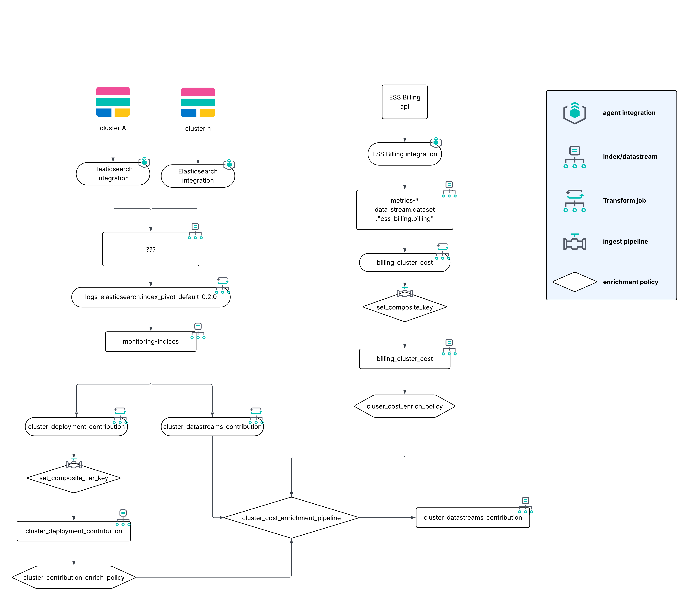

# Elasticsearch Chargeback module

The [Chargeback integration](../integration/Instructions.md) is the supported installation path and receives all ongoing updates. Prefer that path unless you have a hard constraint in the following section.

This module is a legacy, manually assembled alternative. It will not be maintained.

## When to choose the module

Choose the module only when you cannot install the Chargeback integration. The usual case is that the monitoring cluster cannot upgrade to the stack version the integration requires (currently 9.2.0+). See the [integration version compatibility table](../integration/README.md#version-compatibility).

The module can run on Elastic Stack **8.17.1** or later. That is the main reason to use it.

Do not choose the module for convenience or customization. Compared with the integration it has more moving parts, a harder setup, and more failure modes. Field focus and fixes go to the integration only.

If you can upgrade the monitoring cluster to meet the integration requirements, use the [Chargeback integration](../integration/Instructions.md) instead.

## Version

Chargeback module: 0.2.0

## Dependencies

This process must be set up on the **Monitoring cluster**, where all monitoring data is collected.

### Requirements

- The Monitoring cluster must be running Elastic Stack 8.17.1 or later for the module.
- The Monitoring cluster must be hosted on Elastic Cloud (ECH).
- **Elasticsearch Service Billing** integration (version 1.0.0+) must be installed on the Monitoring cluster.
- **Elasticsearch** integration (version 1.16.0+) must collect data from all deployments sending data to the Monitoring cluster.
- The **Transform** `logs-elasticsearch.index_pivot-default-{VERSION}` must be running on the Monitoring cluster.

## Setup instructions

See [Module Instructions.md](Instructions.md) to install the module.

## Data flow

The Chargeback Module is building on two distinct data sets:
- The output of the Elasticsearch Service Billing integration, that is the `metrics-ess_billing.billing-default` index.
- The output of the Elasticsearch integration usage data, specifically that of the `logs-elasticsearch.index_pivot-default-{VERSION}` transform, that is the `monitoring-indices` index.

The first layer of processing that we do, is two transforms:
- From the billing data, we get one value, namely the total ECU (cost), per deployment per day.
- From the usage data, we get values for indexing, querying and storage, per deployment per day.

Once we have these two new data sets, that is the billing data per day and the usage data per day, we perform another transform on the usage data, now also looking at the data stream and data tier, can use these two new data sets to enrich the data tier usage data. The end result is that we know how much indexing, querying and storage is used per deployment, per data tier and per data stream per day. This data is available in the `cluster_datastreams_contribution` index.

Since the enrichments are done on dynamic data, that is both the billing and usage data gets refreshed each day, the enrichment policies need to be executed once a day to be populated with the new data.

One catch is that, if the two integrations have not been running for at least 24 hours before the setup of this Chargeback Module, the enrichment data will be empty, and you will have to wait for 24 hours before the indices are populated.

To be able to take indexing, querying and storage into consideration in a weighted fashion, we create a runtime field on the `cluster_datastreams_contribution` index with the following default weights (which you can change):
- indexing: 20 (only considered for the hot tier)
- querying: 20
- storage: 40

This means that storage will contribute the most to the blended cost calculation, and that indexing will only contribute to this blended cost on the hot tier. You should consider these weights, and adjust these based on your own best judgement.

## Dashboards

Once you have loaded the dashboards, you can navigate to the `[Tech Preview] Chargeback (0.2.0)` dashboard that provides the Chargeback insight into deployments, data streams and data tiers.

The dashboard also links out to:
- `[Tech Preview] Chargeback - Meta Data (0.2.0)` which can be helpful when troubleshooting, as this provides the date ranges that have been parsed, and so on.
- `[Metrics ESS Billing] Billing dashboard`, the dashboard for the Billing integration.
- `[Elasticsearch] Indices & data streams usage (Technical Preview/Beta)`, the dashboard for the Elasticsearch integration usage data.

## Sample dashboard

.png)